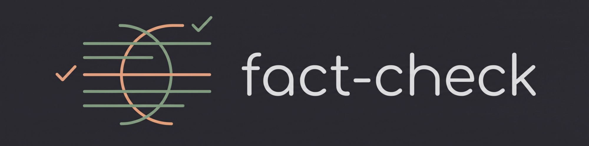
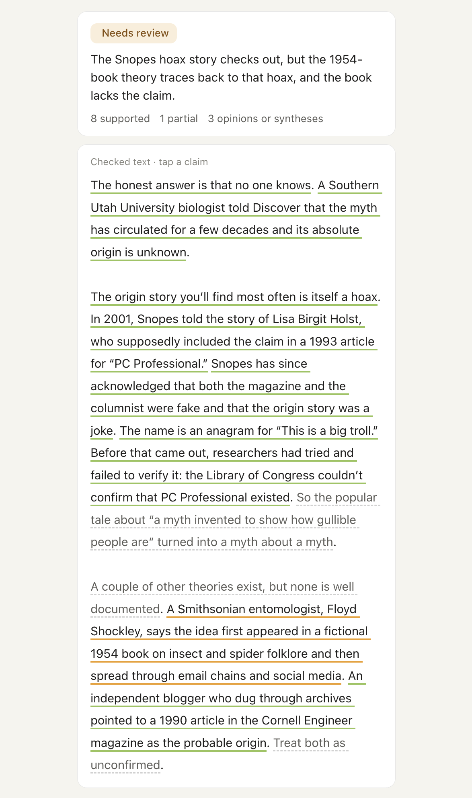

<h1 align="center">
  
</h1>

A [Claude skill](https://docs.claude.com/en/docs/agents-and-tools/agent-skills/overview) that checks whether a text Claude wrote is faithful to the web sources it cites, and whether those sources are reliable and independent of each other. The result is a one-screen HTML report: a verdict, the annotated text, one card per claim, and the list of sources.

It is built for the moment you get an answer from Claude and wonder: *can I trust this? where did that number come from?*

## What it does



**1. Picks the text to check:** a passage you quote, or Claude's last answer, plus the URLs it cited. If the answer cited nothing, the skill searches for sources from scratch.

**2. Hands the analysis to a separate verifier.** When an Agent/Task tool is available, a fresh agent that did not write the text re-fetches every page and checks each claim. Otherwise it runs in the same session but re-fetches every page instead of relying on memory.

**3. Checks each claim** for faithfulness to its source (`supported`, `partial`, `unsupported`, `contradicted`, `unverifiable`, `not_checkable`), rates each source's reliability, groups sources by origin (ten articles rewriting one press release count as one source), and looks for important omissions.

**4. Computes the verdict by fixed rules** instead of asking the model for a judgment. *Problematic*: a critical claim is unsupported or contradicted, or rests only on low-reliability sources. *Reliable*: every critical claim is supported by at least 2 independent sources, and no claim is contradicted, unsupported or unverifiable. *Needs review*: everything else.

**5. Validates and renders the report** with `scripts/render.py`. The script checks the JSON against the schema and every invariant, and recomputes the verdict itself. It also checks every quoted excerpt against the text of the page the verifier saved. An invalid report is never rendered.

*On the left: checking where the "eight spiders a year" myth comes from. The Snopes hoax story holds up, but the 1954-book theory traces back to that same hoax.*

The report is a single self-contained HTML file with no external requests. It works on mobile, has light and dark mode, shows no numeric scores, and never relies on color alone. Each claim links to the exact excerpt on the source page through a text fragment. UI labels are available in English and Italian; the generated content follows the user's language.

<br clear="left">

## Limits

- Excerpts are checked against the page text the verifier's fetch tool returned. Some fetch tools (WebFetch in Claude Code among them) pass pages through a model, so the method asks for the page's own words and rejects anything that reads like a summary. A quote can still differ slightly from the live page, in which case its link opens the page without jumping to the passage.
- The verdict is only as good as the verifier's reading of the sources: it is a guide to where to look, not a final judgment.

## Requirements

- **Python 3.9+**
- **`jsonschema` 4.18 or later**. `render.py` exits with code 3 if it is missing or too old:
  ```bash
  python3 -m pip install --upgrade 'jsonschema>=4.18'
  ```
  If it is missing, the skill installs it by itself only in a sandbox (claude.ai, Cowork). On your own computer (Claude Code) it asks you first.
- **Web access for Claude** (web search and fetch), to re-read the sources.
- **Recommended:** an Agent/Task tool, so the check runs in an independent agent. Claude Code has one.

## Installation

### Claude Code

Copy the `fact-check/` folder into your personal skills folder (available in every project):

```bash
git clone https://github.com/mmariniello90/fact-check.git
```

```bash
cp -r fact-check/fact-check ~/.claude/skills/
```

To make it available in one project only, copy it to `<project>/.claude/skills/` instead.

### Claude apps (claude.ai, desktop)

Download [`fact-check.skill`](https://github.com/mmariniello90/fact-check/releases/latest/download/fact-check.skill) from the [latest release](https://github.com/mmariniello90/fact-check/releases/latest) (it is a zip of the `fact-check/` folder) and upload it under **Settings → Capabilities → Skills**. Code execution must be enabled. If `jsonschema` is not installed in that environment, Claude installs it with the `pip` command above.

## Usage

After an answer you want to check, type:

```
/fact-check
```

Or just ask, in English or Italian:

- "Is this true?", "Check your sources", "Where did you get that number?"
- "Verifica le fonti", "Controlla se è vero", "È affidabile?"

To check only part of an answer, quote the passage in your message.

A check re-reads every source and searches for independent confirmation, so it takes a few minutes and uses a fair number of tokens and web requests: more for long answers with many sources.

Claude publishes the report as an artifact, or sends it as an HTML file if artifacts are not available, and writes a single line in the chat with the verdict and the headline:

> Needs review: The main figure holds up, but one claim is contradicted by its own source.

## Repository layout

```
fact-check/
├── SKILL.md                 # entry point: when to trigger and the 4-step workflow
├── references/
│   ├── method.md            # the verification method the verifier follows
│   └── schema.json          # JSON contract for the report, with x-invariants rules
├── scripts/
│   └── render.py            # validates the JSON and renders the HTML
├── assets/
│   └── report.html          # report template (do not edit generated reports by hand)
└── evals/                   # test fixtures and test runner (not packaged in .skill)
fact-check.skill             # packaged skill, ready to upload
```

## Running the tests

```bash
python3 fact-check/evals/run_tests.py
```

The runner renders every valid fixture and checks the computed verdict. It also checks that every invalid fixture is rejected with the expected rule id. Rendered reports go to `fact-check/evals/out/` by default. Open one in a browser to see what a report looks like.

## Adding a language

UI labels live in the `LABELS` dictionary at the top of the script in `fact-check/assets/report.html`. Copy the `en` block, translate it, and use the language code as its key. Any language without a block falls back to English.

## License

[MIT](LICENSE)
